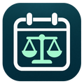

# Court Monitor · 사건 일정 관리

대한민국 법원의 사건 기일과 판결 결과를 조회하는 설치형 프로그램입니다. Synology NAS나 Linux Docker 서버에서 자동 조회를 실행하고 브라우저로 관리합니다. Google Calendar를 연결하면 본인 계정의 사건 전용 캘린더에 기일이 반영됩니다.

[시놀로지 설치 안내](server/SYNOLOGY.md) · [Windows 설치 파일 받기](https://github.com/imueRoid/court-monitor/releases/latest/download/CourtMonitorPC-Setup.exe) · [최신 릴리스](https://github.com/imueRoid/court-monitor/releases/latest) · [Docker Hub 이미지](https://hub.docker.com/r/imueroid/court-monitor)

## 설치 경로

| 실행 환경 | 시작하기 |
| --- | --- |
| **Synology NAS** | Intel/AMD x86_64 NAS의 Container Manager에서 [시놀로지용 Compose 파일](https://raw.githubusercontent.com/imueRoid/court-monitor/main/compose.synology.yaml)을 프로젝트로 실행합니다. [시놀로지 설치 순서](server/SYNOLOGY.md#설치-순서) |
| **일반 Linux Docker 서버** | 저장소의 `compose.yaml`로 소스에서 빌드합니다. 기본 포트는 8080입니다. [Linux Docker 서버 안내](server/README.md) |
| **Windows PC** | Windows 10/11 x64용 독립 앱입니다. 자동 시작, 트레이 실행, 업데이트 알림을 지원합니다. [Windows 설치 및 빌드 안내](WINDOWS-PC.md) |

Synology에서는 컨테이너가 시작되면 `http://NAS-IP:7708`에 접속해 관리자 비밀번호를 정합니다. 이후 같은 주소를 열어 사건을 등록하거나 기존 Windows 조회 이력 JSON을 가져올 수 있습니다.

## NAS 웹 화면에서 할 수 있는 일

- **사건 관리**에서 차회 기일이 빠른 순으로 사건을 확인하고 법원·사건번호·당사자명·판결 내용 등으로 검색합니다.
- 사건 상세를 열어 차회 기일의 시각·장소, 기일 사이 진행 내역과 최근 조회 결과를 확인합니다. 선고 전에는 **변론 진행중** 또는 **변론 종결됨**, 주문을 기다릴 때는 **주문 확인중**으로 표시됩니다.
- 판결 주문이나 종국결과가 확인되면 사건 목록의 **진행 중인 사건** 옆 **종료된 사건** 탭에서 볼 수 있습니다. 민사·행정의 **원고일부승** 같은 종국결과도 여기에 포함됩니다. 상세를 다시 열거나 **지금 확인**을 누르면 법원이 제공한 상소·확정 정보가 갱신됩니다.
- 자동 조회를 중지·재개하고, 사건 목록을 내보내거나 선택한 사건을 한꺼번에 관리할 수 있습니다.

자동 조회는 NAS가 실행 중일 때 동작합니다. 기본 설정에서는 일반 사건을 하루에 한 번, 선고일에는 한국시간 09~19시에 30분 간격으로 하루 최대 8회 확인합니다. 사건·예약·로그인·Google 연결은 SQLite가 있는 데이터 볼륨에 저장됩니다.

## Google Calendar 연결

캘린더 연동은 선택 사항입니다. 설치자마다 본인 Google Cloud 프로젝트에서 웹 OAuth 클라이언트를 만들고, 본인 NAS에만 JSON을 등록합니다. **설정 → Google Calendar 연결 → 처음부터 따라 하는 상세 안내**에서 개인 모드와 Calendar API, HTTPS 또는 localhost 접속, 콜백 URI, JSON 등록과 오류별 해결 방법을 확인할 수 있습니다. [시놀로지 안내의 Google 연결 절차](server/SYNOLOGY.md#google-독립-인증)

## 기존 NAS 설치 업데이트

- **앱 업데이트**는 웹 화면의 **업데이트 적용**에서 실행합니다. 자동 적용이 켜져 있으면 컨테이너 시작 때도 호환 앱 업데이트를 확인합니다. 버전은 화면 상단의 프로그램 이름 옆에서 볼 수 있습니다.
- **이미지 갱신**은 앱에 Docker 이미지 업데이트가 필요하다고 표시되거나 이전 Python 컨테이너에서 처음 Rust 버전으로 옮길 때 진행합니다. 기존 프로젝트와 `court_data` 볼륨을 사용합니다. [Docker 이미지 갱신과 데이터 백업](server/SYNOLOGY.md#업데이트와-백업)

## 소스와 파일 구조

| 경로 | 역할 |
| --- | --- |
| [`compose.synology.yaml`](compose.synology.yaml), [`compose.yaml`](compose.yaml) | Synology 공개 이미지 배포, Linux 로컬 빌드 |
| [`nas/`](nas/) | Rust 서버, 법원 조회, 예약, SQLite, Google Calendar 연동 |
| [`server/static/`](server/static/) | 웹 화면, 로그인, Google Calendar 설정 안내 |
| [`server/`](server/) | 서버 도구와 Python 호환 코드 |
| [`installer/`](installer/) | 독립 Windows 앱 설치 프로그램 구성 |
| [`scripts/`](scripts/), [`tests/`](tests/) | 배포 패키징과 자동 검사 |

[개발·빌드 안내](docs/DEVELOPMENT.md) · [기존 Windows 단일 사건 조회 도구](docs/windows-single-case.md) · [앱 아이콘 PNG](docs/assets/court-monitor-icon.png)
